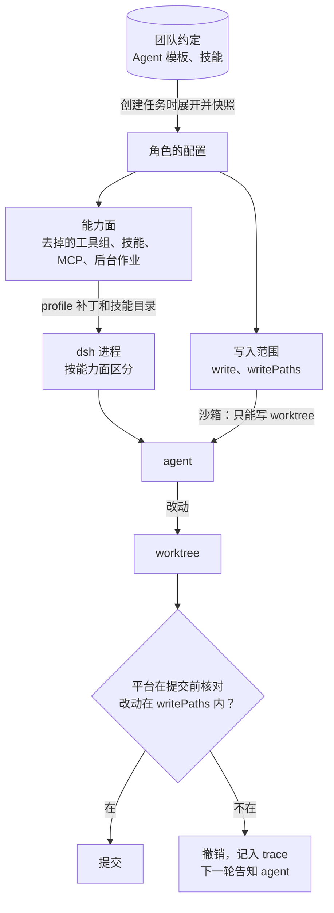

# ADR-003：团队级 Agent 模板

- 状态：已采纳（2026-11-21）。PoC 阶段的验证记录；和 `docs/roadmap.md` 冲突时以路线图为准
- 读者：要理解 Agent 模板、工具限制和路径级写入范围的人
- 关联：ADR-001（平台结构）、ADR-002（团队约定）、ADR-006（部署和沙箱）

## 背景

- 团队成员各用各的 agent 配置：提示词、能用的工具、看得到的技能、能改的文件都不一样。同一个阶段交出来的东西质量参差。
- 工作流和约定文档已经放在平台上统一维护（ADR-002），但「谁来做」仍然写在每个工作流的角色里。同一个「开发」角色在几个工作流里各写一份，改一处漏一处，也无法限制它的权限边界。
- dsh 的能力有三点限制：

| 能力 | dsh 的限制 |
|---|---|
| 工具、技能、MCP | 只能按 dsh 进程配置（启动时的 profile 补丁），不能按会话配置 |
| 工具 | 只能按插件整行关闭。一个能力往往分布在几行里（例如子 agent 相关的工具来自 5 行） |
| 沙箱 | 只能允许或拒绝写整个 worktree，不能限制到子路径 |

## 目标

1. 团队在平台上统一维护 Agent 模板：模型、提示词、技能、MCP、工具和文件写入范围。不同成员发起的任务里，同一个角色行为一致。
2. agent 的操作权限限定在模板约定的边界内：去掉的工具在 agent 进程里不存在，越界写入的文件不会进入提交。
3. 模板和技能有版本，任务记录用了哪一版。

目标 2 指的是 agent 进程本身，不包括平台替它运行的检查命令（ADR-002）。

## 设计

### 总览

模板怎样变成 agent 的边界：

| 方面 | 设计 |
|---|---|
| 存放 | 模板和技能是团队约定的两个类型，存在平台数据库里，只追加、带版本（ADR-002 的机制） |
| 引用 | 工作流的角色按名字引用模板 |
| 工具限制 | 按工具组去掉，由 dsh 进程执行 |
| 写入范围 | 沙箱把写入限制在 worktree 内；路径级的范围由平台在提交前执行 |
| 进程 | 每个（任务 worktree，模型路由，能力面）一个 dsh 进程 |

### 模板和技能

| 类型 | 格式 | 字段 |
|---|---|---|
| 模板 | YAML | `name`、`description`、`model`、`effort`、`prompt`、`write`（`none` 或 `worktree`）、`writePaths`（worktree 内的 glob）、`tools.deny`（工具组）、`skills`（技能名）、`mcp`（stdio 服务） |
| 技能 | Markdown | dsh 的 `SKILL.md` 格式，开头 `---` 之间是 `name` 和 `description` |

- 默认值：`write` 是 `none`；`model` 是 `deepseek-flash`；`write: worktree` 并且省略 `writePaths` 时，可写范围是整个 worktree。只读的角色不能写 `writePaths`。
- 内置的模板：`spec-writer`、`developer`、`reviewer`、`improver`。内置的技能：`write-changes`。内置的 `standard` 工作流引用前三个模板。
- 模板和技能的名字只能用小写字母、数字和连字符，以字母开头，最长 32 个字符，不能用中文。技能名的规则来自 dsh；模板名沿用工作流名的规则。
- 模板的错误分三步报告：字段格式 → 字段之间的约束 → 引用的技能是否存在。前一步有错时看不到后一步的错。

### 工作流引用模板

- 写法：`role: { template: developer }`。引用模板时不能再写别的字段。
- 任务创建时，平台把模板展开进工作流的快照，记录模板的版本，并快照角色用到的技能内容。
- 解析工作流仍然是纯函数：模板由调用方注入的查找函数提供。

**为什么按名字引用**：修改一次模板，所有工作流里的这个角色一起生效。

### 能力面和 dsh 进程

能力面 = 去掉的工具组 + 技能 + MCP + 能否启动后台作业。

- 平台为每个能力面生成一份 profile 补丁和技能目录，放在 dsh 数据目录的 `eos-profiles/<指纹>/` 下。
- 始终关闭插件管理（agent 不能自己安装插件）和 dsh 自带的 Office 技能。
- 技能只从这个能力面的目录读取。dsh 的默认技能根目录被关闭，仓库和用户目录里的技能都看不到。
- 能力面是安全边界，必须提供，没有「省略即不限制」。

**为什么按进程而不是按会话**：dsh 只支持按进程配置。代价是进程更多；得到的是边界由 dsh 自己执行，不依靠提示词让模型自觉。

### 工具组

| 组 | 说明 |
|---|---|
| `web` | 联网 |
| `subagent` | 子 agent |
| `bash` | 执行命令 |
| `schedule` | 定时 |
| `todo` | 待办 |
| `goal` | 目标 |

- 读写文件和向用户提问的工具不属于任何组，始终保留。
- 工具组到 dsh 插件行的映射由平台维护（`src/executor/dsh.ts` 的 `GROUP_ROWS`）。每一组都用真实的 dsh 验证过：去掉后 dsh 正常启动，这一组工具从发给模型的工具表里消失，其余组不受影响。

**为什么按组而不是按单个工具名**：dsh 只能整行关闭工具。让使用者写单个工具名，会造成「写了但关不掉」的假象。

### 路径级写入范围

沙箱把写入限制在 worktree 内。`writePaths` 由平台在提交前执行：

1. 每次可写角色的调用结束后，平台列出 worktree 里的全部改动。
2. 不在 `writePaths` 里的改动被撤销：已跟踪的文件从 HEAD 恢复，新文件删除，改名的两边复原。
3. 撤销记录在这次调用上，在 trace 里可见。
4. 下一次发往同一个会话的提示词开头告知 agent。

**为什么在提交前撤销，而不是阻止写入**：沙箱做不到子路径；在写入的当下拦截需要修改 dsh。提交前撤销保证越界的改动不进入任务分支，并且 agent 会被告知，可以在下一轮改正。

**核对不通过就不提交**

- 撤销之后平台再列一遍改动，提交前再核对暂存区，只暂存范围内的路径。
- 仍有越界的内容时（例如撤销不了的文件）不提交，任务停下等人处理。
- 文件名按原始字节读取。不是合法 UTF-8 的一律算越界。
- 未跟踪的嵌套 git 仓库、指向目录的符号链接、被改动的子模块路径，一律算越界。

**忽略规则只信任仓库自己的**

- 信任的规则：HEAD 里原样的 `.gitignore`、主仓库的 `info/exclude`、宿主机的全局配置。
- 被这些规则忽略的文件不撤销、不提交，留在 worktree 里（例如 `node_modules`）。
- agent 新加或改过的 `.gitignore` 所隐藏的文件，按普通的新文件处理。

### 平台的 git 不信任 worktree 里的 `.git`

agent 能写 worktree，就能修改 worktree 里的 `.git`。因此：

- 平台每次都从主仓库（在沙箱之外）找出这个 worktree 的管理目录，显式带 `--git-dir` 和 `--work-tree` 执行 git。
- 不进入子模块：子模块目录里 agent 能放自己的仓库和 filter 配置。
- 关闭 fsmonitor 和 hooks。
- `.git` 被改过时（换成别的仓库，或指向别的任务的管理目录），任务停下等人处理。

### 撤销时防止写到 worktree 之外

agent 留下的进程可以在平台撤销时，把目录换成指向外面的符号链接，使平台删除或覆盖 worktree 之外的文件。有三层防护：

| 层 | 做法 | 作用 |
|---|---|---|
| 1 | 可写角色的 dsh 不能启动后台作业：去掉 `job_*` 工具和自带后台运行的 `workflow` 工具，bash 不接受 `run_in_background`，前台超时直接结束 | 减少留下进程的途径 |
| 2 | 撤销前关闭这个 worktree 的 dsh 进程（dsh 关闭时结束它的子进程组），再扫描 `/proc` 结束工作目录仍在 worktree 里的进程 | 纵深防护。用 `setsid` 脱离进程组、再 `cd /` 的进程清不掉 |
| 3 | 撤销时的删除、重建目录和写回文件，都在核对过真实路径的目录里执行：先进入上级目录，用 `pwd -P` 确认在 worktree 内；写回时先写到同目录的临时文件，再用 `mv -T` 替换 | 进入之后路径再被替换也不会被引到外面。核对不通过时不操作、不提交 |

第 2 层清不掉的进程只能让撤销失败，删不到、写不到 worktree 之外。

代价：

- 每个可写步骤之后重启 dsh，下一次调用多几秒。
- 第 2 层会结束工作目录在任务 worktree 里、平台有权结束的任何进程，包括使用者自己在那里打开的终端或编辑器。Docker 部署下，平台还以 `eos-agent`、`eos-check` 的身份结束它们留下的进程。不要在平台数据目录的 worktree 里工作。

### MCP 服务

- MCP 服务在 agent 的沙箱之外运行，和 dsh 是同一个用户。往模板里加 MCP 服务，等于给予 dsh 进程级别的信任。模板编辑页有提醒。
- MCP 服务的工作目录是 dsh 数据目录下的 `mcp-cwd`，不是 worktree。配置值不做 `${…}` 展开。服务启动失败时会话失败。
- 模板以明文保存。平台拒绝 `env` 里像密钥的变量名。需要密钥的 MCP 服务不支持。
- dsh 给 MCP 子进程的环境去掉了凭据变量，模型 key 不会经环境变量传给 MCP 服务。但 MCP 服务和 dsh 是同一个用户、又在沙箱之外，能读 dsh 进程的环境，所以仍然读得到模型 key（ADR-006 的「已知限制」）。

## 已知限制

| 限制 | 说明 |
|---|---|
| 路径级写入范围是事后撤销 | 越界的写入在调用进行中真实存在。agent 在这一轮里可以读到、运行自己写的越界文件。平台保证的是它们不进入提交、下一轮被告知 |
| 撤销的归属可能不准 | 撤销在可写角色的下一次调用结束后统一执行。两次调用之间，检查命令或只读角色的 MCP 服务写进 worktree 的未被忽略的文件，会算到这次调用上：范围内的被提交，范围外的被撤销并告知开发 agent |
| 崩溃时可能丢失撤销记录 | 平台在撤销之后、记录之前崩溃时，越界内容不会进入提交，但这次调用记不下被撤销的路径，agent 也收不到通知 |
| 撤销后留下空目录 | 不影响提交 |
| 已跟踪目录里新建的 `.git` 和子模块里的内容不处理 | 它们不在 git 的改动列表里：不撤销，也不进入提交，但留在 worktree 里。子模块路径本身被替换或删除时会被发现并恢复成空目录 |
| 密钥变量名的检查是启发式的 | 只识别 KEY、TOKEN、SECRET、PASSWORD、PASSWD、CREDENTIAL。会漏掉 `GITHUB_PAT`、带密码的连接串、`args` 里的 `--token` 等 |
| 宿主机 git 配置里的 filter 仍可能被选用 | worktree 里的 `.gitattributes` 可以选用宿主机全局或系统配置里定义的 filter（例如 git-lfs）。这些命令不是 agent 能定义的。平台没有隔离全局配置，因为那会去掉提交签名等设置 |
| 部分工具的关闭没有验证 | 有几个工具在测试环境的 dsh 里本来就不出现（`pwsh` 只在 Windows；部分子 agent 工具需要额外条件），关闭对应的行能否去掉它们没有验证 |
| 手动修改模板没有审批 | 见 ADR-002 |

## 没有采用的方案

| 方案 | 不采用的原因 |
|---|---|
| 所有角色共用一个 dsh 进程，按会话配置 | dsh 不支持按会话配置工具、技能和 MCP |
| 让使用者按单个工具名限制 | dsh 只能整行关闭，会出现写了但关不掉的情况 |
| 在写入时拦截越界路径 | 沙箱不支持子路径，需要修改 dsh |
| 用 `GIT_CONFIG_GLOBAL=/dev/null` 隔离宿主机的 git 配置 | 会去掉提交签名等宿主机设置 |

## 涉及的文件

| 范围 | 内容 |
|---|---|
| 工作流 schema | 角色的 `writePaths`、`tools.deny`、`skills`、`mcp`；角色可以是 `{ template }` |
| 引擎 | `replied` 事件和调用记录带被撤销的路径；按会话记录还没告知的撤销 |
| 执行器 | `src/executor/dsh.ts`：能力面、`GROUP_ROWS`、进程按能力面区分 |
| runner | `src/runner/git.ts`（撤销和提交）、`src/runner/procs.ts`（结束残留进程） |
| 存储 | 约定的 `template`、`skill` 两类；任务元数据记录模板和技能的版本，并快照技能内容 |
| Web | 团队约定页的「Agent 模板」「技能」；任务页显示模板和技能的版本；trace 的调用详情显示被撤销的越界改动 |

## 重新评估的条件

- dsh 支持按会话配置工具、技能或 MCP：可以改回所有角色共用一个进程，减少进程数。
- dsh 的沙箱支持子路径：路径范围改由沙箱在写入时拒绝。
- 需要带密钥的 MCP 服务：接入平台的凭据存储（路线图第 9 项）。

## 证据

| 结论 | 证据 |
|---|---|
| dsh 的三点限制；每个工具组去掉后的效果 | `docs/e2e/b2/template-probe.json` |
| 撤销时的两种竞态，三层防护后各 1000 轮为 0 次；修复前删到外面 1 次、覆盖外面 4 次 | `scripts/revert-race.ts`、`docs/e2e/fix-28/` |
| 撤销时不跟随符号链接 | `tests/write-scope.test.ts` |
