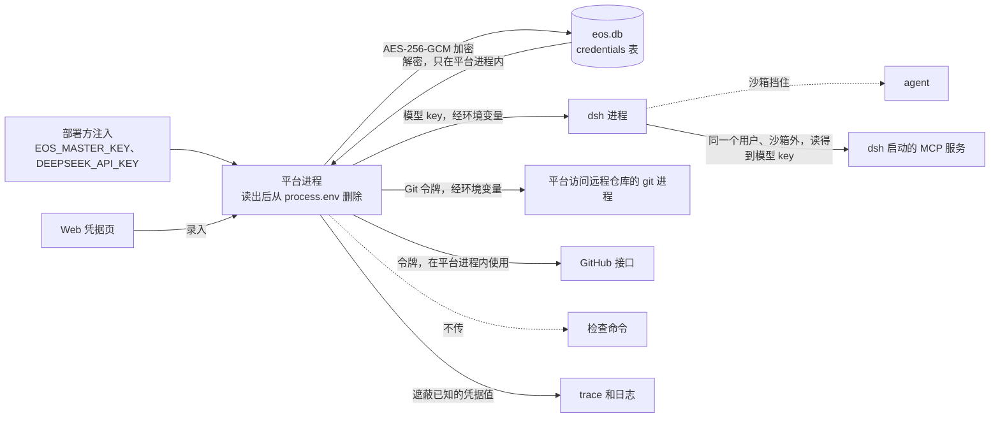

# ADR-005：凭据存储

- 状态：已采纳（2026-11-24），内容按当前实现维护
- 读者：要理解或修改凭据存储设计的人
- 关联：ADR-006（Docker 部署中谁能读到主密钥和模型 key）、ADR-007（GitHub 用户授权）

## 背景

- 平台要访问真实仓库（克隆、推送、开 PR），要调用模型，以后还要连接带密钥的 MCP 服务。这些都需要凭据。
- 凭据只由平台持有：agent 看不到令牌；提交、推送、开 PR 都由平台完成。
- 平台部署在团队共用的服务器上，现在没有登录。
- agent 的沙箱能读整个文件系统（只限制写）。因此磁盘上平台用户能读的文件，agent 都能读到。

## 目标

1. 凭据加密保存在平台的数据库里，在 Web 上管理。模型 key、Git 令牌、GitHub App 凭据、GitHub 用户令牌、以后的 MCP 密钥都用它。
2. 凭据按 owner 分开保存。接上登录时把 owner 换成用户 id，不需要迁移数据。
3. 主密钥和凭据的值不进入 agent 进程和检查命令的环境，不写进 worktree，不出现在 trace 和日志里。

## 设计

### 总览

主密钥和凭据的走向。虚线表示不传递或被挡住。图里的「不传」说的是平台不主动交出；别的进程能否自己读到，取决于部署方式，见「谁能读到主密钥和模型 key」：

| 方面 | 设计 |
|---|---|
| 主密钥 | 环境变量 `EOS_MASTER_KEY`，32 字节，base64 编码，由部署方注入。不写到磁盘 |
| 加密 | 每条凭据单独用 AES-256-GCM 加密 |
| 存放 | 和任务在同一个 SQLite 文件（`eos.db`）里，表 `credentials`，主键是 owner 和名字 |
| owner | 现在只有一个：`local` |
| 读取 | 值只在平台进程内解密。列表接口不返回值 |
| 遮蔽 | 检查输出、trace、任务日志、服务日志里出现的已知凭据值替换成 `***` |

### 主密钥

- 平台启动时读出 `EOS_MASTER_KEY`，随即从 `process.env` 里删除。之后启动的子进程（dsh、git、检查命令）继承不到它。
- 主密钥不写到磁盘。原因：agent 能读整个文件系统，放在磁盘上等于让 agent 读到。
- 主密钥的指纹是它的 SHA-256 的前 16 个十六进制字符。

| 主密钥的状态 | 平台的行为 | `eos doctor` |
|---|---|---|
| 已设置且格式正确 | 正常 | ✓，显示指纹 |
| 没有设置 | 照常运行，但不能保存或读取凭据。仍能列出和删除凭据 | ⚠，给出生成方法 |
| 设置了但格式不对 | 不启动 | ✗ |

- 格式不对时不启动，是为了让配置错误立刻暴露。
- 「不启动」指运行任务和启动服务的命令（`run`、`resume`、`retry`、`improve`、`web`）。查看状态、日志等命令照常执行。

### 加密

- 算法：AES-256-GCM。每条凭据一个随机的 12 字节 IV，认证标签 16 字节。
- 认证数据绑定版本号、owner、名字和类型。把一行的密文挪到另一行（换成别人的，或换成另一种凭据）时解密失败。
- 每条凭据记录加密它的主密钥的指纹（`key_id`）。更换主密钥后，平台能明确指出哪一条需要重新录入，而不是笼统的解密失败。

### 凭据的种类

| 类型 | 内容 |
|---|---|
| `api-key` | 模型服务的 key |
| `token` | Git 托管服务的令牌（个人访问令牌等） |
| `github-app` | GitHub App 的凭据（JSON）：id、私钥、client id、client secret 等。平台用它换短期的安装令牌。见 ADR-007 |
| `github-user` | 某个人通过 GitHub App 授权给平台的用户令牌（JSON，带刷新令牌）。见 ADR-007 |

- 名字只能由小写字母、数字和 `.`、`_`、`:`、`-` 组成，以字母或数字开头，最长 64 个字符。
- 值最大 16 KiB。
- 名字前缀 `github-app.` 和 `github-user.` 保留给平台，不能在凭据页手工使用。
- 数据库里出现当前版本不认识的类型时（例如新版本写入后退回旧版本），列表里显示为 `unknown`，可以找到并删除。

### 读取和列表

- 列表接口只返回名字、类型、主密钥指纹和时间，不解密。
- 凭据的值只有平台进程内部能取得。
- 凭据存储使用自己的数据库连接，存储层不和任务逻辑耦合。

### 模型 key 的来源

- 平台先读凭据存储里名为 `deepseek` 的凭据，没有时才用启动时环境变量 `DEEPSEEK_API_KEY` 的值。
- 凭据存储里有 `deepseek` 但读不出来时（没有主密钥、换了主密钥、记录损坏），平台不退回环境变量，直接报错、不启动。原因：避免用错 key。
- 环境变量在启动时读出并从 `process.env` 删除。之后平台启动的 git、检查命令继承不到它，只有 dsh 进程得到模型 key。
- 模型 key 必须交给 dsh 进程：这一版 dsh 的模型服务只接受环境变量名（`apiKeyEnv`）。写进配置文件会落在磁盘上，agent 的沙箱能读到。

### 遮蔽

- 文字里出现的已知凭据值替换成 `***`。应用于检查输出、trace、任务日志、服务日志。
- 短于 8 个字符的值不遮蔽：短字符串在普通文字里很常见，替换会误伤。
- 值经过 base64 编码后的形式也遮蔽（例如 Git 认证头）。只识别标准 base64 的连续写法，不识别 URL 安全的写法和中间换行的写法。替换后两端最多各留下一个和值有关的字符。
- 值经过 JSON 转义后的写法也遮蔽。
- JSON 格式的凭据里，名字含 key、secret、token、password、pem 的字段单独遮蔽。
- 遮蔽的对象还包括：主密钥本身、环境变量里的模型 key、运行时换来的短期令牌。
- 凭据增加、修改、删除后，遮蔽的清单最迟一秒后更新。

## 没有采用的方案

| 方案 | 不采用的原因 |
|---|---|
| 主密钥放在数据目录外的一个文件里 | 文件在磁盘上，agent 的沙箱能直接读到 |
| 主密钥在数据目录里自动生成 | 不需要配置，但只能防「数据库单独泄露」这一种情况；agent 和拿到整个数据目录的人都能解密 |
| 系统钥匙串或云上的 KMS | 服务器上不一定有。以后需要时可以更换主密钥的来源，凭据的格式不变 |

## 已知限制

| 限制 | 说明 |
|---|---|
| 主密钥始终在平台进程的初始环境里 | `/proc/<pid>/environ` 保存的是进程启动时的环境，从 `process.env` 删除改变不了它 |
| 模型 key 在 dsh 进程的环境里 | 原因见「模型 key 的来源」 |
| 平台的启动器启动的 esbuild 服务进程也带着启动时的环境 | 它在平台代码运行之前由 tsx 启动 |
| 丢失主密钥后，存过的凭据只能重新录入 | 没有恢复手段 |
| 没有登录，所有凭据属于同一个 owner | 能访问平台的人都能使用平台的凭据 |
| 没有轮换主密钥的功能 | 更换主密钥后，旧的凭据要重新录入 |

## 谁能读到主密钥和模型 key

读到主密钥就能解开全部凭据。任何以平台的用户、在沙箱外运行 agent 写的代码的进程，都能读到平台进程环境里的主密钥。结果取决于部署方式：

| 部署方式 | 检查命令 | agent |
|---|---|---|
| Docker 部署（ADR-006） | 读不到主密钥和模型 key：它以独立的用户运行 | 读不到主密钥：它以独立的用户运行。读不到模型 key 只依赖沙箱 |
| 不用 Docker、直接运行 | 能读到主密钥和模型 key：它以平台的用户、在沙箱外运行 agent 改过的代码 | 沙箱生效时读不到 |

- dsh 在沙箱外启动的 MCP 服务读得到模型 key，两种部署方式都一样。不用 Docker 时它还能读到主密钥。
- agent 读不到的结论是在内核 6.18、Landlock 下验证的。更换内核或沙箱后端后需要重新验证。
- 沙箱和独立用户的设计见 ADR-006。

不用 Docker 部署时，不要在共用的服务器上保存真实凭据。

## 涉及的文件

| 范围 | 文件 |
|---|---|
| 凭据存储 | `src/credentials/key.ts`（主密钥）、`store.ts`（存储和加密）、`types.ts`（对外类型）、`model-key.ts`（模型 key 的来源）、`redact.ts`（遮蔽） |
| 启动和检查 | `src/cli.ts`（启动时读出主密钥）、`src/runner/doctor.ts`（「凭据主密钥」「凭据隔离」两项） |
| Web | `src/web/server.ts` 的 `/api/credentials` 接口，以及凭据页 |

## 证据

| 结论 | 证据 |
|---|---|
| 不用独立用户时，检查命令能读到主密钥和模型 key | `docs/e2e/deploy-2-image/sandbox/checks-env-probe.json` |
| 沙箱生效时 agent 读不到 dsh 进程环境里的模型 key（内核 6.18、Landlock） | `docs/e2e/deploy-2-image/sandbox/modelkey-probe.json` |
| Docker 部署下检查命令和 agent 读不到主密钥 | `docs/e2e/deploy-3b-check-user/`、`docs/e2e/deploy-3c-agent-user/` |
