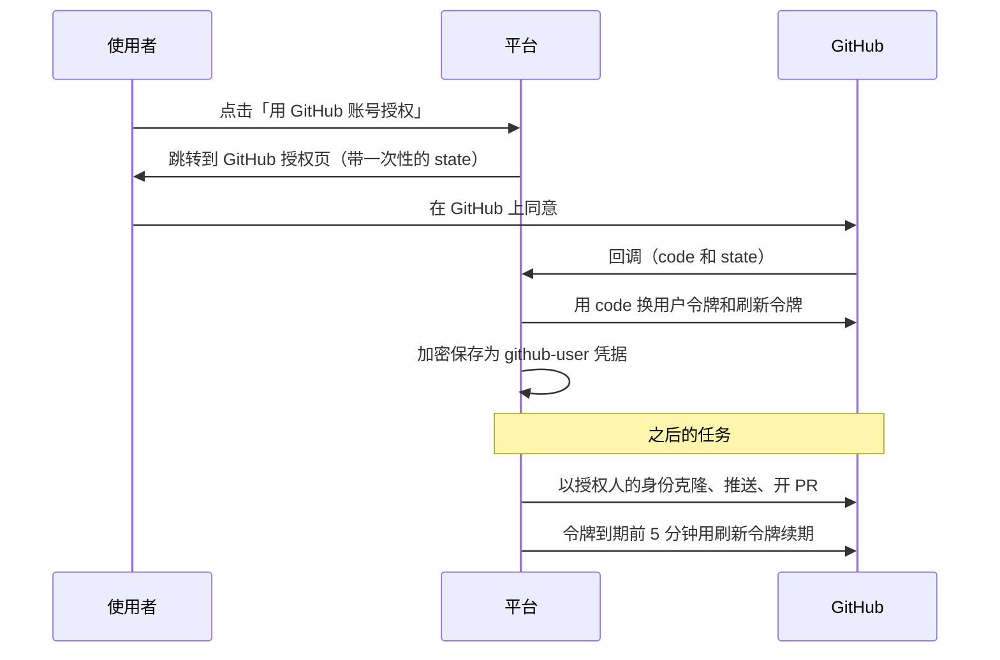

# ADR-007：GitHub 用户授权，平台以授权人的身份推送和开 PR

- 状态：已采纳（2026-11-25），内容按当前实现维护
- 读者：要理解或修改 GitHub 认证设计的人
- 关联：ADR-005（凭据存储）

## 背景

- 平台要克隆仓库、推送任务分支、开 PR，需要一种 GitHub 身份。
- 平台已经支持 GitHub App：用清单流程注册 App，用安装令牌访问仓库。以 App 的身份开的 PR，作者是 `<App>[bot]`。
- 需求是 PR 的作者是真实的人，并且授权方式和 Claude 访问 GitHub 的方式一致：在页面上连接 GitHub 账号，再安装 GitHub App。这种方式是 **GitHub App 的用户授权**（user access token），不是经典的 OAuth App。

## 目标

1. 一个人在网页上点击「用 GitHub 账号授权」后，平台能以他的身份克隆、推送、开 PR，PR 的作者是这个人。
2. 权限不超过 App 申请的权限，也不超过 App 安装到的仓库。令牌过期时平台自动续期。
3. 令牌只由平台持有：加密存放，不进入 agent 和检查命令的环境，不进入 trace 和日志。
4. 授权失效时明确报告原因，不悄悄换成别的身份。

## 设计

### 总览

授权的过程：

| 方面 | 设计 |
|---|---|
| 授权方式 | GitHub App 的用户授权 |
| 凭据 | 凭据类型 `github-user`，名字是 `github-user.<主机>` |
| 认证顺序 | 授权人的令牌 → App 的安装令牌 → 个人令牌 → 匿名 |
| 续期 | 到期前 5 分钟自动续期，同一时间只允许一次 |
| 范围 | 没有登录，全平台共用一个授权 |

### 为什么用 GitHub App 的用户授权

| | 经典 OAuth App | GitHub App 的用户授权 |
|---|---|---|
| 能访问的仓库 | 申请 `repo` 权限后，授权人的所有私有仓库 | 只有「App 安装到了、并且这个人有权限」的仓库 |
| 令牌有效期 | 不过期 | 8 小时，依靠刷新令牌（半年）续期。前提是 App 开启了令牌过期（新注册的 App 默认开启）；没有开启时令牌不过期，平台不续期 |
| 注册 | 手工在 GitHub 上创建应用，再把 client id 和 secret 抄进平台 | 清单流程注册 App 时直接得到 client id 和 secret |

### 凭据

- **App 凭据**保存 App 的 id、私钥、client id、client secret、App 的名字和页面地址，以及用户授权的完整回调地址（访问平台的地址加 `/api/forge-apps/user-callback`）。
- 发起授权时访问平台的地址必须和注册 App 时相同，否则报错。更换访问地址后要删除 App 凭据并重新注册。
- 没有 client id 的 App 不能用于用户授权，页面提示删除后重新注册。
- **用户令牌**是凭据类型 `github-user`，值是 JSON：授权人、所属 App 的 client id、令牌、到期时间、刷新令牌、刷新令牌的到期时间。
- 用户令牌绑定到授权时的 App。删除 App 重新注册后，旧的授权不能使用，平台报错并要求重新授权。
- 用户令牌只能在代码托管页通过授权得到，不能在凭据页手工填写。原因：手工填写的令牌没有刷新令牌，也无法确认是谁的。

### 认证顺序

用户令牌的权限是「授权人的权限」和「App 的权限」的交集。

| 情况 | 使用的身份 |
|---|---|
| App 安装到了这个仓库，并且有人授权过 | 授权人的令牌 |
| App 安装到了这个仓库，没有人授权 | App 的安装令牌 |
| App 没有安装到这个仓库 | 凭据页的个人令牌 |
| 以上都没有 | 匿名 |

两种情况不往下退：

- **授权已失效**（在 GitHub 上被撤销、刷新令牌过期，或 App 已重新注册）：平台直接报错并提示重新授权，不改用 App 的身份。原因：改用 App 的身份会让 PR 的作者改变，而使用者看不出来。
- **App 出错**（App 凭据读不出来、私钥不对、接口超时）：平台直接报错，不退回个人令牌，也不匿名。只有「App 没有安装到这个仓库」才退回个人令牌。

在平台上撤销授权（删除用户令牌）等于没有人授权，之后使用 App 的安装令牌。

### 续期

- 令牌到期前 5 分钟续期。令牌被 GitHub 拒绝过时，下次使用前强制续期；续期失败即判定授权已失效。
- GitHub 每次续期都换发一个新的刷新令牌，旧的作废。因此同一个授权在同一时间只能有一次续期。

| 并发的范围 | 处理 |
|---|---|
| 同一进程内 | 并发的请求共用一次续期 |
| 跨进程（命令行和 Web 同时运行） | 用锁文件排队，等 30 秒拿不到锁时报错。拿到锁后重新读一遍凭据；如果已经和续期前读到的不同，说明另一个进程刚续过，直接使用新的 |

- 续期等待 GitHub 回复期间，凭据被换成另一个人的或被删除时，续期完成后以那一边为准，不写回。被删除时按没有人授权处理。
- 回调写入和撤销不拿续期的锁。

### 授权流程

- state 是 32 字节随机数，30 分钟有效，只能使用一次，只保存在内存里。平台重启后进行中的授权失效。
- 进行中的流程最多 32 个，超过时拒绝新的（429），不挤掉已有的。
- 一种流程的 state 不能用来完成另一种流程（注册 App 和用户授权各用各的）。
- 回调时用发起授权时记下的回调地址换取令牌。

### 撤销

1. 调用 GitHub 的接口撤销这次授权。
2. 删除平台保存的令牌。

- GitHub 一侧撤销失败、续期失败，或平台读不出授权或 App 凭据时，平台仍然删除令牌，并提醒使用者到 GitHub 上手动撤销。
- 撤销前令牌即将过期时先续期。原因：GitHub 不接受过期的令牌，用它撤销会返回 404，而授权和刷新令牌仍然有效。

### 和其他认证方式的关系

App 的安装令牌和个人令牌仍然可用，作为没有人授权时的备用。

## 已知限制

| 限制 | 说明 |
|---|---|
| 全平台共用一个授权 | 没有登录，凭据的 owner 都是 `local`。所有任务都以授权人的身份推送：能建任务的人，就能以他的身份往安装了 App 的仓库推分支、开 PR |
| 授权可以被诱导 | 见下文 |
| 没有使用 PKCE | GitHub 支持 `code_challenge`，平台没有使用 |

**授权可以被诱导**

- 进行中的授权（state）只保存在平台内存里，不和发起它的浏览器绑定。
- 能访问平台的人可以自己发起授权，把 GitHub 授权页的地址发给另一个人（例如仓库管理员）。对方在真实的 github.com 上点击同意后，平台就以他的身份推送。
- 没有登录时无法阻止。解法是把 state 和发起它的登录会话绑定，这依赖登录。

共用授权和诱导授权这两项，都依赖登录和多人（路线图第 7 项）才能解决：登录后每个人使用自己的授权。没有登录时，能访问平台的人本来就能使用平台的全部凭据。

## 涉及的文件

| 范围 | 文件 |
|---|---|
| 代码托管 | `src/forge/github-oauth.ts`、`src/forge/types.ts`、`src/forge/github.ts`、`src/forge/github-app.ts` |
| 凭据类型 | `src/credentials/types.ts` |
| 运行 | `src/runner/supervisor.ts`（认证顺序、续期）、`src/runner/mirror.ts`（报错） |
| Web 接口 | `src/web/server.ts`、`src/web/types.ts`（授权、回调、撤销） |
| 网页 | `web/src/` 下的 `ForgeApps`、`Credentials`、`api` |
