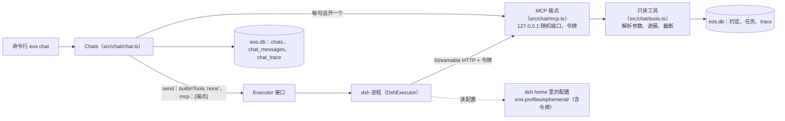

# ADR-008：对话 agent——只读平台数据，经平台的 MCP 端点交给 agent

- 状态：已采纳（2026-11-26），内容按当前实现维护
- 读者：要理解或修改对话 agent 的人，以及要换执行器的人
- 关联：ADR-004（improver 的权限做法）、ADR-005（凭据和遮蔽）、ADR-006（部署里的用户）

对话 agent 是一个不绑定任务、可以多轮对话的 agent。它只能用平台提供的只读工具读平台数据，没有执行器自带的任何工具。工具经平台在本机开的 MCP 端点交给它。

## 背景

- 团队需要一个对话入口，用来问平台上的工作流、约定、模板、技能和任务，以及设计工作流。
- 读取范围：工作流、约定文档、Agent 模板、技能、任务列表，单个任务的状态、trace、指标、改动摘要。不读仓库代码，读不到凭据。
- agent 只能读，不能保存任何东西。
- 平台没有登录，能打开平台的人都能和它对话。
- dsh 自带文件读写、搜索工具。任务角色只能按工具组关掉命令行、联网等，关不掉这两类。它们开着时，agent 能读数据目录（数据库、所有仓库、所有 trace）。

## 目标

1. 对话不绑定任务，多轮，记录存进数据库，平台重启后能接着聊。
2. agent 只有平台提供的只读工具，没有执行器自带的工具。
3. 工具返回的内容先遮蔽已知凭据值。
4. 对话的模型调用记进单独的 trace 和指标，用途名 `chat`，不混进任务。
5. 执行器可以替换：`src/chat/` 只认 `Executor` 接口和它的类型。

## 设计

### 总览

| 方面 | 设计 |
|---|---|
| 运行方式 | 经 `Executor` 接口，能力面由平台定死：`builtinTools: 'none'`、`write: 'none'`，`mcp` 里只有这次调用的端点 |
| 工具 | 8 个只读工具，一张表定义；没有写操作，没有读凭据、读仓库文件的工具 |
| 端点 | 每次调用开一个，调用结束就关；端口随机，令牌 32 字节随机数 |
| 存储 | `chats`、`chat_messages`、`chat_trace` 三张表，在 `src/chat/store.ts` 里建 |
| 模型和提示词 | 内置 Agent 模板 `assistant`，团队可以改；权限不从模板读 |
| 失败就关 | 执行了平台工具以外的工具时，这一轮作废 |

### 能力面怎么表达

`src/executor/types.ts` 的 `AgentProfile` 有两个和执行器无关的字段：

| 字段 | 含义 |
|---|---|
| `builtinTools: 'standard' \| 'none'` | `none`：执行器自带的工具一个都没有，agent 只能用 `mcp` 里的工具。任务角色用 `standard` |
| `mcp: AgentMcp[]` | 模板里写的本地 stdio 服务，或者 `HttpMcp`：平台提供的标准 MCP 端点（Streamable HTTP），带请求头 |

执行器不支持其中某一项时，`send` 必须抛错，不能悄悄忽略。

dsh 的翻译只写在 `src/executor/dsh.ts`：

- `none` 关掉 sdk profile 里所有提供工具的插件行（`BUILTIN_TOOL_ROWS`），以及会把本机文件内容带进会话的行（消息里的 @文件引用、工作区的 `AGENTS.md`）。
- `HttpMcp` 翻译成 dsh MCP 客户端的 `streamable-http` 配置，不重连。

**为什么用中立字段**：对话 agent 是「一个只有平台工具的角色」。任何执行器实现了这两个字段，对话功能就能跑在上面，`src/chat/` 不用改。

### 只读工具

| 工具 | 返回 |
|---|---|
| `list_conventions`、`get_convention`、`convention_history` | 工作流、约定文档、Agent 模板、技能的列表、内容、版本历史 |
| `list_tasks`、`get_task` | 任务列表；单个任务的状态、当前位置、失败原因、产出（截断）、记录摘要 |
| `get_task_trace` | 不给 call 时是每次调用的摘要；给 call 时是这次调用的事件（长内容截断） |
| `get_task_metrics` | 任务的阶段指标 |
| `get_task_changes` | 改动的文件列表和增删行数，不含文件内容和 diff |

- 参数在边界按 zod schema 解析。
- 返回先遮蔽再截断，每个工具最多 20000 字。
- 任务的 trace 和产出里可能带着任务 agent 读过的代码片段。trace 在读取范围内，这些片段跟着返回。

**为什么先遮蔽再截断**：先截断的话，截断处可能留下半截凭据，遮蔽按完整的值匹配，认不出来。

### 端点

- 只接受 `POST /mcp`、`application/json` 的请求，只回 JSON，不开 SSE 流。
- 请求体最多 64 KiB，不接受批量请求。
- 一次调用最多 30 次工具调用，到上限后的调用都返回错误（也记进「读了哪些数据」）。
- Host 必须是 `127.0.0.1:<端口>`；带 Origin 的请求一律拒绝。
- 令牌按定长比较：两边各算 sha256，再用 `timingSafeEqual`。

**为什么令牌是唯一的防线**：同一台机器上的其他进程都连得到 127.0.0.1 的端口，包括别的任务的 agent 和检查命令。Host 和 Origin 的检查只挡浏览器。

### 令牌在 dsh 配置里的处理

dsh 只能从配置文件读 MCP 的请求头，所以令牌会写进 `<数据目录>/dsh/eos-profiles/ephemeral/<指纹>/cordis.patch.yml`。

| 处理 | 做法 |
|---|---|
| 权限 | 目录 2750、文件 0640，属于平台用户 eos、组 eos-dsh。`eos-profiles` 带 setgid，新目录继承组；文件显式改成目录的组。dsh（eos-agent）靠组 eos-dsh 读 |
| 调用结束 | dsh 进程关掉时删掉整个目录；dsh 进程没起来时马上删掉 |
| 崩溃留下的 | 平台进程第一次写配置时，删掉超过一小时没改过的目录 |
| 端点关闭后 | 令牌没有用处：端口上已经没有服务 |

**为什么只删一小时以前的**：同一个数据目录可能有两个平台进程（网页和命令行），另一个进程正在进行的调用不能被删。

### 对话的存储和续接

- `chats`：每个对话一行。`chat_messages`：只追加，角色是 user、assistant、error。`chat_trace`：已遮蔽的事件流。
- assistant 记录带用量、耗时，以及读了哪些数据（工具名和参数，参数存之前遮蔽）。
- 执行器的会话按 key `chat/<对话 id>` 续接。还没有回复过的对话带上模板的提示词，之后只发用户的话。
- 平台重启时一句话的调用可能没做完。下一句之前先向执行器认领回复（`findReply`），认领不到就记一条「没有回复」。
- 同一个对话同一时间只有一次调用（锁 `chat-<id>`）。

**为什么每句话都换令牌**：令牌只在一次调用里有效，泄露的影响限在这次调用的时间里。代价是配置的指纹每次都变，每句话起一个新的 dsh 进程。

### 换执行器时要做什么

新执行器实现 `Executor` 接口，并支持 `AgentProfile` 的两个字段：

1. `builtinTools: 'none'`：不给 agent 任何自带工具；
2. `mcp` 里的 `HttpMcp`：让 agent 能用这个端点的工具，带上 `headers`。

`src/chat/` 不用改。

## 没有采用的方案

| 方案 | 不采用的原因 |
|---|---|
| 新写一个直连模型 API 的执行器，工具在平台进程内 | 对话功能会绑定在这个专用执行器上；续接、重试、上下文压缩要再做一遍 |
| stdio 的 MCP 子进程直接读数据库 | 子进程以 dsh 的用户运行，读不到平台的数据库，也拿不到主密钥，做不了遮蔽 |
| stdio 子进程中转到平台的 unix socket | 令牌同样要交给子进程，还多一层进程 |

## 已知限制

| 限制 | 说明 |
|---|---|
| 同用户的任务 agent 在调用期间能读到令牌 | 部署镜像里 dsh 和所有任务的 agent 都是 eos-agent，在组 eos-dsh 里，读得到配置文件。调用进行期间，别的任务的 agent 能拿令牌读遮蔽过的平台数据。任务 agent 本来就能读整个 `/data`，没有扩大暴露面。和 `docs/roadmap.md` 的「任务之间的隔离」是同一个问题 |
| 不用 Docker 部署时 | 平台、dsh、检查命令是同一个用户，都读得到配置文件 |
| 每句话起一个 dsh 进程 | 令牌每次都换，配置的指纹跟着变 |
| 工具返回里可能有提示词注入 | trace、任务产出里有其他 agent 写的文字。对话 agent 没有写工具，最坏是回答被带偏 |
| 没有登录 | 对话的 actor 只记 `cli`、`web`，和任务事件的写法一样 |
| `BUILTIN_TOOL_ROWS` 按当前 dsh 版本列 | dsh 新增的工具行不会自动关掉。E2E 核对发给模型的工具表；运行时还有「失败就关」 |

## 涉及的文件

| 范围 | 文件 |
|---|---|
| 执行器接口和 dsh 翻译 | `src/executor/types.ts`、`src/executor/dsh.ts` |
| 对话 | `src/chat/types.ts`、`store.ts`、`tools.ts`、`mcp.ts`、`chat.ts`、`cli.ts` |
| 模板 | `src/workflow/agents/assistant.yaml` |
| 命令行接线 | `src/cli.ts` |
| 测试 | `tests/chat.test.ts`、`tests/mcp-executor.ts`（不调模型、按标准 MCP 连端点的假执行器）、`tests/executor.test.ts` |
| 验证脚本 | `scripts/chat-e2e.ts`、`scripts/chat-docker-probe.ts` |

## 证据

| 结论 | 证据 |
|---|---|
| 真实 dsh 发给模型的工具表里只有 8 个 `mcp__eos__*` 工具；两轮对话跨进程续接；trace 里的凭据值被遮蔽；调用结束后配置里没有令牌 | `docs/e2e/chat-a/report.json` |
| 部署镜像里 eos-check、eos-agent 不带令牌和带错令牌都被拒；容器里跑通一次 `eos chat`，配置是 2750/0640、组 eos-dsh，eos-check 读不到，eos-agent 读得到，调用结束后删掉 | `docs/e2e/chat-a/docker-probe.json` |
| 最终代码上真实 dsh 的工具表、遮蔽、令牌清理（假模型） | `docs/e2e/chat-a/fake-model-report.json` |
| `src/chat/` 不经过 dsh 也能跑通 | `tests/chat.test.ts`、`tests/mcp-executor.ts` |
| 配置的权限和组、删除、崩溃后清理；任务角色的指纹不变 | `tests/executor.test.ts` |
