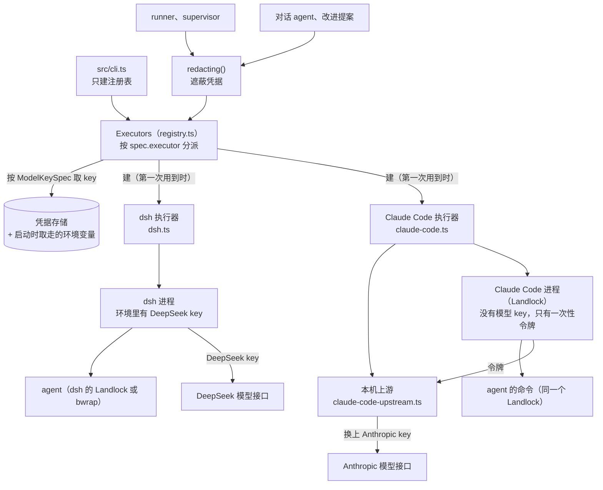

# ADR-009：执行器接口——执行器是可以替换的部件

- 状态：已采纳（2026-11-28），内容按当前实现维护
- 读者：要理解执行器怎么接进平台、要加一个执行器、或者要改凭据和沙箱相关代码的人
- 关联：ADR-003（能力面、Agent 模板）、ADR-005（凭据存储、模型 key 的来源）、ADR-006（部署里的用户和沙箱）、ADR-008（对话 agent 的 MCP 端点）

平台跑 agent 的部分叫执行器。现在有两个：dsh（默认）和 Claude Code。角色、Agent 模板、对话用 `executor` 选执行器，不写时用默认执行器。引擎、runner、对话 agent、改进提案只认 `src/executor/types.ts` 的 `Executor` 接口；执行器在 `src/executor/registry.ts` 里登记，`src/cli.ts` 只建注册表。换一个执行器时，`src/executor/` 以外的代码不用改。

## 背景

- 平台起初只有 dsh，代码里有 4 处按 dsh 写死：启动时直接建 dsh；`eos doctor` 调 dsh 的函数；能力面按 dsh 的插件划分；部署和权限按 dsh 的行为写。
- 路线图要求执行器中立：每家 agent 用它自己最完整的接口，模型质量是硬要求。
- 第二个执行器 Claude Code 和 dsh 的差别很大：凭据交给它，agent 就能读到；它自己的沙箱在部署镜像里用不了；会话日志的格式不同。

## 目标

1. 新功能只认 `Executor` 接口和它的类型，不按某个执行器的特性写。
2. 执行器做不到的要求（例如去不掉某个工具组）在建任务、建对话时就报出来，不能悄悄忽略。
3. 每个执行器自己声明要哪个模型 key、自检什么、失败时怎么修。
4. 凭据只由平台持有，不进 agent 能运行代码的进程；每个执行器各自用它能做到的办法做到这一点。
5. CI 对每个执行器跑同一套测试。

## 设计

### 总览

| 方面 | 设计 |
|---|---|
| 接口 | `Executor`：`send`、`findReply`、`traceOf`、`release`、`close`，可选的 `failureHint` |
| 登记 | `ExecutorKind`：名字、能力面、模型 key、失败的修法、怎么建、怎么自检。`EXECUTORS` 的第一个是默认执行器 |
| 选执行器 | 角色、Agent 模板写 `executor`；对话建时定下，记在 `chats` 表的 `executor` 列。不写时用默认执行器 |
| 能力面 | 和执行器无关的 `AgentProfile`；执行器声明 `Capabilities`，平台用 `checkExecutor` 提前核对 |
| 模型 key | 执行器声明 `ModelKeySpec`；平台按它取 key，交给执行器的是取 key 的函数 |
| 自检 | 执行器的 `health` 给出 `eos doctor` 的几项、是否在沙箱里、能不能以 agent 的用户运行 |
| 约束 | ESLint 规则：执行器的包只在自己的文件里，执行器的名字只出现在 `src/executor/` 里 |

### 接口和注册表

- `send` 在 key 对应的会话里发一条消息，等它完成。同一个 key 总是同一个会话；消息里带 nonce。
- `findReply`、`traceOf` 按 key 和 nonce 从执行器自己的会话日志里找回回复、回放 trace：平台崩溃后续跑时用。调用方传那次调用用的执行器名字，注册表只问那个执行器。
- `release` 结束这个 worktree 占用的进程；`close` 结束全部。
- 注册表本身实现 `Executor`。每种执行器第一次用到时才建：没用到的执行器装没装好，不影响别的执行器。
- 平台给 runner 和对话的执行器是注册表外面包一层 `redacting()`（`src/credentials/redact.ts`）：回复、trace、提问、报错、失败的修法都先遮蔽凭据再交出去。

**为什么找回时要传执行器名字**：两个执行器里可能有同一个 key 和 nonce 的会话。只问那次调用用的执行器，才不会认错；那个执行器建不起来时报出原因，不当成「没有回复」去重发。

### 能力面

| 类型 | 含义 |
|---|---|
| `AgentProfile` | 一个 agent 要什么：自带工具有没有（`builtinTools`）、去掉哪些工具组、技能、MCP、能不能起后台作业 |
| `Capabilities` | 执行器能做到什么：每个工具组 `removable`（能去掉）、`absent`（本来就没有）或 `fixed`（去不掉）；能不能关掉全部自带工具、关掉后台作业；接不接得了 HTTP、stdio 的 MCP；支不支持技能 |
| `needsOf`、`unmet` | 从能力面算出要求，和执行器的能力比，列出做不到的（中文，每条一句） |

- 建任务时 supervisor、建对话时对话 agent 用 `checkExecutor` 核对；`send` 时注册表再核对一次。
- 执行器没有的工具组算已经满足（例如 Claude Code 没有 todo、goal 两组）；`fixed` 的一律拒绝。
- 每个执行器把能力面翻译成自己的配置：dsh 是 profile 补丁和技能目录（ADR-003）；Claude Code 是 `tools` 白名单、本地插件里的技能、`mcpServers`，加上每次工具调用前的检查（`PreToolUse` hook）。

**为什么用白名单**：Claude Code 不限制时的工具表里有跨会话消息（`SendMessage`、`ListAgents`）、换工作目录（`EnterWorktree`）这类工具，SDK 升级时工具表会变。只给白名单里的，新出现的工具拿不到。

### 模型 key

- 每个执行器声明 `ModelKeySpec`：凭据存储里的名字、启动时从环境变量里取走的变量名、在 doctor 里显示的名字。dsh 是 `deepseek` / `DEEPSEEK_API_KEY`，Claude Code 是 `anthropic` / `ANTHROPIC_API_KEY`。
- 平台启动时按全部执行器的声明从 `process.env` 里取走这些变量（`takeKeyEnv`）；每次要用时先读凭据存储，没有才用取走的值（`resolveModelKey`，ADR-005）。
- 执行器拿到的是取 key 的函数，每次调用重新取：在 Web 上换了 key，之后的调用就用新的。
- key 怎么交给执行器自己的进程由执行器决定，见「谁能读到模型 key 和 MCP 令牌」。

### 自检和失败的修法

- `health` 返回 `eos doctor` 的几项（`ok`、`warn`、`fail`）、agent 是否在沙箱里、设置了 agent 的用户时能不能以它运行。
- 启动前检查（启动 Web 和会跑 agent 的命令之前）里，`fail` 拦下，`warn` 只提示；标了 `doctorOnly` 的只在 `eos doctor` 里列出。
- dsh 的各项（模型 key、安装、沙箱、`EOS_MODEL_BASE_URL`）没准备好时是 `fail`，平台不启动。所有角色都用 Claude Code 时也一样。
- Claude Code 没准备好（没装好、没有 key、没有 Landlock）只在 `eos doctor` 里显示 ⚠，用它的角色在调用时报错。`EOS_ANTHROPIC_BASE_URL` 不合法时是 `fail`。
- 调用失败时，runner 先问那次调用用的执行器（`failureHint`，来自 `ExecutorKind.failureHints`），执行器认不出时才用 `src/engine/failure.ts` 的通用说法。具体的凭据名、环境变量、模型接口主机只出现在执行器给的修法里。

**为什么 Claude Code 没准备好不拦下启动**：不是每个部署都用 Claude Code。总会出现的 ⚠ 会让人习惯性忽略真正的提示，所以只在 `eos doctor` 里列出。

### 两个执行器

| | dsh | Claude Code |
|---|---|---|
| 进程 | 每个（worktree、模型路由、能力面）一个 dsh 进程，跨调用常驻 | 每次调用一个 Claude Code 进程（`query()`），这一轮结束就退出 |
| 会话 id | 由 key 算出 | 由 key 算出的 UUID；第一次新建，之后续接 |
| 能力面 | profile 补丁，按指纹分进程 | 按调用给：`tools` 白名单、插件、`mcpServers`；`settingSources: []`，不读仓库和用户目录的设置、指令文件 |
| 沙箱 | dsh 自己的 bwrap，用不了时 Landlock | 平台的 Landlock 启动器（`landlock.ts`）套住整个 Claude Code 进程，用不了时拒绝调用。可写的范围见「agent 在哪里运行」 |
| 模型 key | 经环境变量交给 dsh 进程 | 不交给 Claude Code，见下一节 |
| 提问 | `ask_user_question`，可以长时间挂起 | `AskUserQuestion` 经 `canUseTool` 交给平台，等待期间进程一直挂着 |
| 会话日志 | zstd 多帧的 jsonl，在 dsh 的数据目录 | 普通 jsonl，在 `<数据目录>/claude-code/sessions/<会话 id>/` 下 |
| 部署 | 以 `eos-agent` 运行（`deploy/dsh-launch.mjs`） | 平台用 `setpriv` 切换到 `eos-agent`、清掉能力，再套 Landlock |
| 默认模型 | `deepseek-flash` | `claude-sonnet-5-5` |

**为什么 Claude Code 套平台的 Landlock，不用它自己的沙箱**：它自己的沙箱用 bwrap，在部署镜像（Docker 默认的 seccomp）里建不了 user namespace（ADR-006）；开着它再套 Landlock 时它起不来。

### 谁能读到模型 key 和 MCP 令牌

模型 key 和 MCP 令牌都只由平台持有，交给执行器的方式不同。这一节说的令牌有两种：Claude Code 每次调用的一次性令牌（上游只认它），对话 agent 每次调用的 MCP 令牌（ADR-008）。两种都只在那次调用期间有用。

**部署镜像里**（ADR-006 的用户）：

| 进程 | 用户 | 能读到的 | 读不到的 |
|---|---|---|---|
| 平台（含 Claude Code 的本机上游） | `eos` | 主密钥、全部模型 key、两种令牌（都是它发的） | — |
| dsh 进程 | `eos-agent`，不在沙箱里 | DeepSeek key（环境变量）；对话用 dsh 时的 MCP 令牌（配置文件，见表下第一条）；正在跑的 Claude Code 进程的一次性令牌（同一个用户，读得到它的 `/proc/<pid>/environ`） | Anthropic key、主密钥 |
| dsh 在沙箱外启动的 stdio MCP 服务 | `eos-agent`，不在沙箱里 | 和 dsh 进程一样（继承 dsh 的环境，ADR-006） | Anthropic key、主密钥 |
| dsh 的 agent（工具子进程） | `eos-agent`，在沙箱里 | 对话用 dsh 时的 MCP 令牌（配置文件） | 模型 key、一次性令牌：沙箱挡住读别的进程的环境 |
| Claude Code 进程 | `eos-agent`，在 Landlock 里 | 这次调用的一次性令牌（环境变量 `ANTHROPIC_API_KEY`）；对话用 Claude Code 时的 MCP 令牌（经 SDK 的控制通道交给它，不在命令行和环境里） | 模型 key、主密钥 |
| Claude Code 的 agent 的命令、它启动的 stdio MCP 服务 | `eos-agent`，同一个 Landlock | 这次调用的一次性令牌（继承 Claude Code 的环境）；对话用 dsh 时的 MCP 令牌（配置文件） | 模型 key、主密钥；别的调用的一次性令牌（别的 Landlock 域） |
| 检查命令 | `eos-check` | 都读不到：环境是白名单，不是别的进程的用户，也不在 `eos-dsh` 组里 | 全部 |

- 对话用 dsh 时，MCP 令牌在调用期间写在 `dsh/eos-profiles/ephemeral/<指纹>/cordis.patch.yml`（0640，组 `eos-dsh`）。所有以 `eos-agent` 运行的进程都在这个组里，沙箱只限制写，所以都读得到。这是 ADR-008「已知限制」里的一条。
- 对话 agent 是唯一拿到 HTTP MCP 端点的 agent，它没有自带工具（`builtinTools: 'none'`），自己运行不了命令。任务里的角色只有模板写的 stdio MCP 服务，不带密钥（ADR-003）。
- 一次性令牌只在本机上游登记。上游只听 127.0.0.1，定长比较，调用结束就撤销；只转发 `POST /v1/messages`（和 `count_tokens`）到配置的 Anthropic 地址，不跟随重定向，请求体和回复各有上限。拿到令牌的进程在那次调用结束前能经上游调模型，拿不到真 key。
- `redacting()` 遮住模型 key、主密钥、凭据存储里的凭据和平台登记过的 Git 令牌。两种令牌不在其中：agent 把环境打印出来时，一次性令牌会出现在 trace 里。执行器自己的会话日志（`dsh/`、`claude-code/sessions/` 下）不经过遮蔽。

**不用 Docker 部署时**：所有这些进程和平台是同一个用户。平台启动时从 `process.env` 里删掉主密钥和模型 key，但进程的初始环境（`/proc/<pid>/environ`）里还在（ADR-005）。所以不在沙箱里的进程——dsh 进程、dsh 在沙箱外启动的 MCP 服务、检查命令——读得到主密钥，能解开凭据存储，等于读得到全部模型 key 和令牌。在沙箱里的进程（dsh 的 agent、Claude Code 和它的命令）仍然读不到别的进程的环境。

**为什么 Claude Code 的 key 走本机上游**：交给 Claude Code 进程的 key，agent 的命令能从自己的环境和 Claude Code 进程的环境里读到（`poc/claude-code/README.md`）。dsh 做不到这一点：这一版 dsh 只能从环境变量拿模型 key（ADR-005），所以 dsh 那边靠沙箱挡住 agent。

### agent 在哪里运行

每个执行器自己决定它的进程怎么起：在平台所在的机器上起；部署镜像里切换到 `eos-agent`、清掉能力；套什么沙箱（dsh 用它自己的 bwrap 或 Landlock，Claude Code 用平台的 Landlock 启动器）。Claude Code 和它起的命令只能写自己的会话目录和 `/tmp`，可写的角色还能写 worktree。接口里没有「沙箱」或「运行位置」这一层：同一台机器上的任务共用用户、`/tmp` 和依赖缓存（ADR-006「沙箱不限制什么」）。

### 约束怎么保持

| 规则 | 在哪 |
|---|---|
| dsh 的包只在 `dsh.ts`，Claude Agent SDK 只在 `claude-code.ts`；`landlock.ts` 只用 Landlock 启动器 | `.github/lint/eslint.config.mjs` |
| `src/cli.ts` 只能引用执行器的 `types` 和 `registry` | 同上 |
| `src/executor/` 以外不能出现执行器的名字（字面量、模板字符串） | 同上 |
| 每个登记的执行器跑同一套接口测试 | `tests/executor-contract.test.ts`（真的启动 Claude Code，模型接口换成本机的假接口） |
| 每个执行器跑同一个确定性 E2E | CI 的 `e2e-fake-model`（dsh）、`e2e-fake-model-claude-code` |

### 加一个执行器要做什么

1. 在 `src/executor/<名字>.ts` 实现 `Executor`，导出一个 `ExecutorKind`：能力面（做不到的如实写 `fixed` 或 `false`）、`ModelKeySpec`、`failureHints`、`create`、`health`。
2. 在 `registry.ts` 的 `EXECUTORS` 里登记。
3. 在 `tests/executor-contract.test.ts` 的 `FACTORIES` 里给它一个不调模型的构造。
4. 在 ESLint 规则里把它的包限定在它自己的文件里，名字加进执行器名字的清单。
5. 凭据：按「谁能读到模型 key 和 MCP 令牌」的标准决定 key 怎么交给它；它的会话日志、数据目录在部署里属于谁（`deploy/eos`）。
6. 让 `scripts/fake-model/script.ts` 认得它的工具名，在 `scripts/e2e-ci.ts`、`scripts/e2e.ts` 可选的执行器里加上它，在 CI 里加一个确定性 E2E 的 job。

## 没有采用的方案

| 方案 | 不采用的原因 |
|---|---|
| Claude Code 用它自己的沙箱 | 在部署镜像里用不了（bwrap 建不了 user namespace），也套不进 Landlock |
| 把 Anthropic key 经环境变量交给 Claude Code | agent 的命令能读到 |
| 用黑名单去掉 Claude Code 的工具 | 新版本加的工具会默认放进来 |
| MCP 的配置经命令行交给 Claude Code（SDK 的默认） | 命令行（`/proc/<pid>/cmdline`）本机任何用户都能读，对话的 MCP 令牌会泄露 |
| 执行器做不到的要求在调用时悄悄忽略 | 能力面是安全边界，做不到要说出来 |
| 每个功能为每个执行器写一份 | 换执行器要改执行器以外的代码，违背目标 1 |

## 已知限制

| 限制 | 说明 |
|---|---|
| 所有角色都用 Claude Code 时平台启动仍要 DeepSeek key | 默认执行器的启动检查照旧 |
| 对话用 dsh 时，同时在跑的任务的 agent 能读到对话的 MCP 令牌 | 见 ADR-008「已知限制」 |
| dsh 进程和它在沙箱外起的 MCP 服务读得到正在跑的 Claude Code 的一次性令牌 | 同一个用户、不在沙箱里；能在那次调用结束前经上游调模型，拿不到真 key。和路线图第 16 项「任务之间的隔离」是同一个问题 |
| 两种令牌不在遮蔽的范围里 | 一次性令牌会出现在 agent 打印环境的 trace 里；调用结束后没用 |
| 对话用 Claude Code 时 MCP 令牌是否写到磁盘 | 测过不在命令行和环境里；没有核对 Claude Code 会不会把 MCP 的请求头写进它的配置目录 |
| 调用期间 agent 能借令牌调模型 | 用额度受限的 Anthropic key（ADR-006「已知限制」） |
| Claude Code 的 agent 能改自己会话的记录 | 它要写自己的会话目录；写不了别的会话，但读得到所有会话的日志（ADR-006「已知限制」） |
| Claude Code 只在 Linux 上可用 | 依赖 Landlock；macOS 上拒绝调用 |
| Claude Code 起的 stdio MCP 服务能读到这次调用的令牌 | 它们继承 Claude Code 的环境，和 agent 的命令在同一个 Landlock 里；调用结束前能经上游调模型，拿不到真 key。和路线图第 16 项「任务之间的隔离」是同一个问题 |
| Claude Code 的提问期间进程一直挂着 | 用户迟迟不回答时占着一个进程 |
| 实时 trace 里每一步的输出 token 不准 | SDK 的实时消息带的是流开始时的用量；会话日志回放和调用记录里的是最终值 |
| `landlock.ts` 用的启动器来自 dsh 依赖的 `@deepseek-ai/node-addon-system` | 在 `package.json` 里单独声明；升级 dsh 时可能跟着换版本 |

## 涉及的文件

| 范围 | 文件 |
|---|---|
| 接口和注册表 | `src/executor/types.ts`、`src/executor/registry.ts` |
| 执行器 | `src/executor/dsh.ts`；`src/executor/claude-code.ts`、`src/executor/claude-code-upstream.ts`、`src/executor/landlock.ts` |
| 用接口的地方 | `src/cli.ts`、`src/runner/supervisor.ts`、`src/runner/runner.ts`、`src/runner/doctor.ts`、`src/chat/chat.ts`、`src/web/chat.ts`、`src/credentials/redact.ts`、`src/credentials/model-key.ts`、`src/engine/failure.ts` |
| 部署 | `deploy/eos`（`/data/claude-code`）、`compose.yaml` |
| 约束和测试 | `.github/lint/eslint.config.mjs`、`tests/executor-contract.test.ts`、`tests/claude-code-executor.test.ts`、`scripts/fake-model/`、`scripts/e2e-ci.ts`、`.github/workflows/ci.yml` |
| 文档 | `docs/deploy.md`「用 Claude Code 执行器」 |

## 重新评估的条件

- 路线图第 16 项「任务之间的隔离」定下每个任务一个独立的沙箱（例如每个任务一个容器）时：进程在哪里起、套什么沙箱从各执行器里拆出来，成为执行器以外的一个接口；「谁能读到模型 key 和 MCP 令牌」一节按新的边界重写。

## 证据

| 结论 | 证据 |
|---|---|
| Claude Code 跑完 feature 模板全流程（真实模型） | `docs/e2e/claude-code-executor/report.json`、`run.log` |
| 内置模板改成和执行器无关的提问说法后，dsh 照常提问（真实模型） | `docs/e2e/claude-code-executor/dsh-real/` |
| 部署镜像里 Claude Code 的沙箱、用户、令牌：别的任务的 agent 和检查命令用不了上游 | `docs/e2e/claude-code-executor/docker-probe.log` |
| 两个执行器跑同一个确定性 E2E | `docs/e2e/executor-ci/` |
| key 不进 Claude Code 和 agent；MCP 的令牌不在命令行和环境里；上游只认登记过的令牌 | `tests/claude-code-executor.test.ts` |
| 交给 Claude Code 的 key，agent 能读到 | `poc/claude-code/README.md` 的「环境隔离」 |
